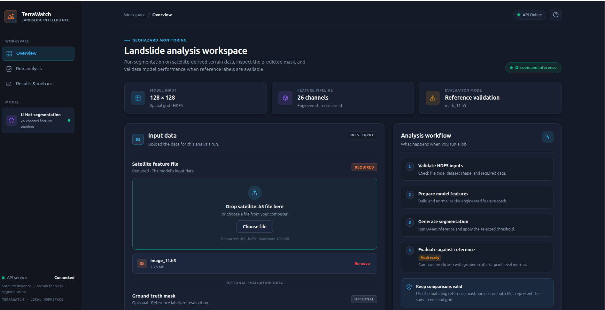
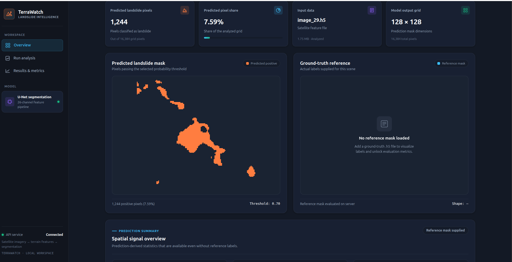
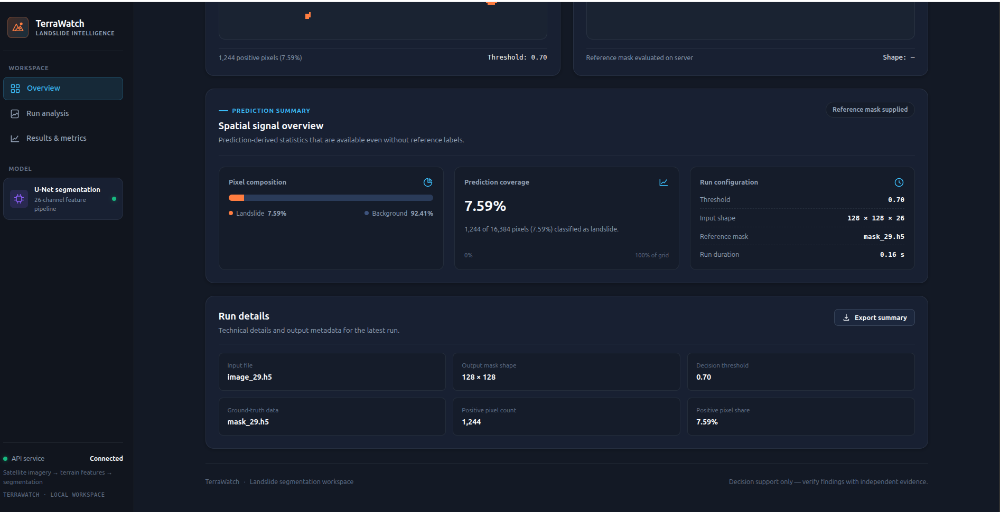

<div align="center">

# 🌍 TerraWatch
### Satellite-Based Landslide Segmentation & Geohazard Intelligence

[](https://www.python.org/)
[](https://www.tensorflow.org/)
[](https://fastapi.tiangolo.com/)
[](https://www.hdfgroup.org/)
[](https://aws.amazon.com/ec2/)

**An end-to-end geospatial deep learning application that transforms 14-channel satellite terrain data into a 26-channel engineered tensor, runs U-Net semantic segmentation, visualizes pixel-level landslide masks in real time, and supports reference-mask validation.**

[📸 Interface Gallery](#-application-walkthrough) • [🧠 26-Channel Pipeline](#-model--feature-engineering) • [🏗️ Architecture](#️-system-architecture) • [🚀 Quick Start](#-run-locally) • [☁️ AWS Deployment](#️-aws-ec2-deployment)

---



</div>

---

## 📌 Project Overview

Landslides threaten lives, critical infrastructure, and ecosystems. Rapidly identifying affected terrain from multi-spectral satellite imagery helps analysts inspect hazardous zones and prioritize field investigation.

**TerraWatch** moves landslide segmentation beyond a standalone Jupyter Notebook into a full-stack, deployable geospatial intelligence workspace hosted on **AWS EC2**. It integrates:

1. **A 26-Channel Feature Engineering Pipeline** that expands raw `128 × 128 × 14` satellite/terrain HDF5 inputs with spectral indices (NDVI, NDMI, NBR), spatial filters, directional gradients, and edge maps.
2. **A TensorFlow/Keras U-Net Segmentation Engine** normalized with training-set statistics (`normalization_stats_26ch.npz`) for consistent on-demand inference.
3. **A FastAPI Backend & Interactive Dark-Slate Dashboard** supporting real-time probability thresholding, HTML5 `<canvas>` mask rendering, spatial signal breakdowns, and JSON report exports.

### Operational Modes
- **Prediction Mode:** Upload a satellite feature HDF5 (`.h5` / `.hdf5`) file to generate a binary landslide segmentation mask, inspect positive pixel coverage, and dynamically tune the decision threshold (`0.05` – `0.95`).
- **Reference Validation Mode:** Optionally attach a matching ground-truth HDF5 mask to compare predictions against reference labels and unlock pixel-level overlap metrics (Dice, IoU, Precision, Recall, Specificity, and Confusion Matrix counts).

> **Methodological Note:** Expanded feature representations provide richer spatial and spectral cues, but model quality must always be established on a held-out test set using fixed splits and documented evaluation protocols.

---

## 📸 Application Walkthrough

### 1. Geohazard Analysis Workspace & HDF5 Input Validation
Upload `128 × 128` HDF5 satellite feature files with client- and server-side validation, monitor live FastAPI health status, and optionally attach ground-truth reference masks (`mask_11.h5`) for evaluation.


---

### 2. Real-Time U-Net Segmentation & Threshold Inspection
Inspect the predicted landslide footprint on an interactive HTML5 canvas. In the run below (`image_29.h5` at threshold `0.70`), the model identifies **1,244 landslide pixels** (`7.59%` of the `16,384`-pixel grid). Adjusting the threshold slider dynamically re-renders the mask in the browser without re-running backend inference.



---

### 3. Spatial Signal Overview & Run Telemetry
Review prediction-derived statistics available on every run—even when ground-truth labels are absent—including **Pixel Composition** (`7.59%` Landslide vs. `92.41%` Background), **Run Configuration** (`128 × 128 × 26` tensor, `0.16 s` inference latency), and one-click **JSON Summary Export**.



---

## 🧠 Model & Feature Engineering

### Challenge: The 14-Channel Raw Input Baseline
Source satellite patches are stored as HDF5 tensors of shape **`(128, 128, 14)`**. While training a U-Net directly on the 14 raw bands serves as an essential baseline, raw multi-sensor channels present several practical modeling challenges:

- **Heterogeneous Scales & Distributions:** Optical bands and digital elevation/terrain derivatives span vastly different numerical ranges.
- **Implicit Spectral Relationships:** Vegetation stripping, soil moisture shifts, and burn scars are governed by band ratios rather than raw single-band intensities.
- **Severe Class Imbalance:** Landslide pixels frequently occupy `< 10%` of a scene, meaning naive pixel accuracy can exceed `90%` even when the model misses hazard zones.
- **Topographic & Spectral Ambiguity:** Terrain shadows, bare rock, riverbeds, and agricultural clearing can mimic landslide reflectance signatures.

### Solution: The 26-Channel Engineered Feature Stack
To expose domain-relevant physical and spatial cues directly to the convolutional filters, TerraWatch transforms the 14 source channels into a normalized **`(128, 128, 26)`** tensor:

| Feature Group | Channels | Role in Landslide Segmentation |
|---|---:|---|
| **Original Satellite & Terrain Bands** | `14` | Preserves all raw multi-spectral and topographic source signals |
| **RGB Composite Channels** | `3` | Provides a normalized visible-spectrum representation |
| **Spectral Indices (`NDVI`, `NDMI`, `NBR`)** | `3` | Highlights vegetation loss, moisture anomalies, and surface disturbance |
| **Grayscale Intensity** | `1` | Captures overall local luminance for structural filtering |
| **Gaussian & Median Spatial Filters** | `2` | Suppresses high-frequency sensor speckle while preserving regional context |
| **Sobel / Directional Gradients ($G_x, G_y$)** | `2` | Emphasizes steep scarps, slope transitions, and directional boundaries |
| **Canny Edge Map** | `1` | Explicitly delineates sharp crown and toe landslide boundaries |
| **Total Engineered Tensor** | **`26`** | **Unified `(128, 128, 26)` input to the U-Net encoder** |

### Training–Inference Parity Contract
A common failure mode in deployed ML systems is training–serving skew. TerraWatch enforces strict preprocessing parity across six sequential stages:

1. **Ingest:** Read the `128 × 128 × 14` HDF5 dataset.
2. **Validate:** Check dimensions, data types, and finite numeric values (`NaN` / `Inf` guards).
3. **Engineer:** Compute the 12 additional spectral and spatial channels in the exact training order.
4. **Normalize:** Apply channel-wise standardization using frozen training statistics (`models/normalization_stats_26ch.npz`).
5. **Infer:** Execute forward pass through `models/best_landslide_unet.keras` (~160 ms per patch).
6. **Threshold & Evaluate:** Convert continuous probabilities $[0, 1]$ into a binary mask at threshold $\tau \in [0.05, 0.95]$.

> **Zero Data Leakage Rule:** Normalization statistics (`mean` and `std` per channel) are computed strictly on the training split and frozen in `normalization_stats_26ch.npz`. Validation, test, and live inference patches are never normalized using their own batch statistics.

---

## 🏗️ System Architecture

```text
Browser Dashboard (HTML5 Canvas + Vanilla JS)
      │
      ├─► GET  /health (or /api/v1/health) ──► Live API Status Pill
      │
      └─► POST /api/v1/predict-upload (multipart/form-data: file, mask_file, threshold)
                │
                ▼
      ┌───────────────────────────────────────────┐
      │ 1. HDF5 Input & Schema Validation         │
      │    Verify .h5 format & (128, 128, 14)     │
      └───────────────────┬───────────────────────┘
                          ▼
      ┌───────────────────────────────────────────┐
      │ 2. 26-Channel Feature Engineering         │
      │    + RGB (3) + NDVI/NDMI/NBR (3)          │
      │    + Gray (1) + Filters (2) + Edges (3)   │
      └───────────────────┬───────────────────────┘
                          ▼
      ┌───────────────────────────────────────────┐
      │ 3. Frozen Training-Stat Normalization     │
      │    models/normalization_stats_26ch.npz    │
      └───────────────────┬───────────────────────┘
                          ▼
      ┌───────────────────────────────────────────┐
      │ 4. TensorFlow / Keras U-Net Inference     │
      │    models/best_landslide_unet.keras       │
      └───────────────────┬───────────────────────┘
                          ▼
      ┌───────────────────────────────────────────┐
      │ 5. JSON Response + Optional GT Validation │
      │    • 128×128 Probability & Binary Masks   │
      │    • Positive Pixel Count & Grid Share %  │
      │    • Optional: Dice, IoU, Precision,      │
      │      Recall, Specificity & TP/FP/TN/FN    │
      └───────────────────────────────────────────┘
```

---

## 🧰 Technology Stack

| Layer | Technologies |
|---|---|
| **Deep Learning** | TensorFlow, Keras, Custom U-Net Architecture |
| **Geospatial & Array Processing** | NumPy, `h5py` (HDF5), OpenCV, SciPy |
| **Backend API** | Python, FastAPI, Uvicorn, Pydantic |
| **Frontend Workspace** | Semantic HTML5, Custom Dark-Slate CSS3, Vanilla ES6+ JavaScript, HTML5 `<canvas>` |
| **Model Artifacts** | `best_landslide_unet.keras`, `normalization_stats_26ch.npz` |
| **Cloud Infrastructure** | AWS EC2 (Ubuntu Linux) |

---

## 📂 Project Structure

```text
TerraWatch/
├── app/
│   ├── main.py                        # FastAPI application entrypoint
│   ├── routes/
│   │   ├── health.py                  # Health check endpoints
│   │   ├── prediction.py              # HDF5 upload & U-Net inference route
│   │   └── evaluation.py              # Reference mask comparison utilities
│   ├── services/
│   │   ├── inference_input.py         # HDF5 reader & shape validation
│   │   ├── inference_preprocessing.py # Normalization & tensor assembly
│   │   ├── preprocessing.py           # 14ch → 26ch feature engineering
│   │   └── model_inference.py         # Model loader & prediction wrapper
│   ├── static/
│   │   ├── css/
│   │   │   └── style.css              # Geohazard dark-theme stylesheet
│   │   └── js/
│   │       └── app.js                 # Upload, canvas rendering & live metrics
│   └── templates/
│       └── index.html                 # Jinja2 workspace template
├── docs/
│   └── images/
│       ├── workspace-overview.png     # Workspace & upload UI screenshot
│       ├── segmentation-output.png    # Predicted mask & metrics screenshot
│       └── spatial-signal-summary.png # Spatial signal & run details screenshot
├── models/
│   ├── best_landslide_unet.keras      # Trained 26-channel U-Net weights
│   └── normalization_stats_26ch.npz   # Training split channel mean/std
├── tests/                             # Automated unit & integration tests
├── requirements.txt                   # Python package dependencies
└── README.md
```

---

## 🚀 Run Locally

### 1. Clone the Repository

```bash
git clone [https://github.com/](https://github.com/)<YOUR_USERNAME>/TerraWatch.git
cd TerraWatch
```

### 2. Create and Activate a Virtual Environment

```bash
python -m venv .venv
source .venv/bin/activate        # Linux / macOS
# .venv\Scripts\Activate.ps1     # Windows PowerShell
```

### 3. Install Dependencies

```bash
pip install --upgrade pip
pip install -r requirements.txt
```

### 4. Verify Model Artifacts

Ensure both trained artifacts exist in the `models/` directory:

```text
models/best_landslide_unet.keras
models/normalization_stats_26ch.npz
```

### 5. Launch the FastAPI Server

```bash
uvicorn app.main:app --host 0.0.0.0 --port 8000 --reload
```

- **Web Dashboard:** [http://127.0.0.1:8000](http://127.0.0.1:8000)
- **Interactive Swagger UI:** [http://127.0.0.1:8000/docs](http://127.0.0.1:8000/docs)

---

## 📊 Segmentation Evaluation Metrics

When a matching ground-truth HDF5 mask is supplied, TerraWatch evaluates predictions across six complementary metrics and a pixel-level confusion matrix:

| Metric | Formula | Operational Meaning | Key Caveat |
|---|---|---|---|
| **Dice Score (F1)** | $\frac{2TP}{2TP + FP + FN}$ | Primary harmonic overlap score between predicted and reference landslide pixels | Closely coupled with IoU |
| **IoU (Jaccard)** | $\frac{TP}{TP + FP + FN}$ | Strict intersection-over-union overlap | Penalizes both false alarms and missed zones |
| **Precision** | $\frac{TP}{TP + FP}$ | Reliability of predicted positive landslide pixels | Low precision = high false-alarm rate |
| **Recall (Sensitivity)** | $\frac{TP}{TP + FN}$ | Fraction of actual landslide pixels detected | Low recall = missed hazard zones |
| **Specificity** | $\frac{TN}{TN + FP}$ | Fraction of stable background terrain correctly excluded | Inflated when background dominates |
| **Pixel Accuracy** | $\frac{TP + TN}{TP + TN + FP + FN}$ | Overall grid agreement | Misleading under heavy class imbalance |

---

## ☁️ AWS EC2 Deployment

TerraWatch has been deployed and tested on an **AWS EC2 instance**.

- **Production Checklist:**
  - Restrict EC2 Security Group ingress rules to required ports (`80`/`443` via Nginx reverse proxy).
  - Run `uvicorn` under a `systemd` service unit for automatic restart on reboot.
  - Enforce request body size limits (`100 MB` max upload) and strict `.h5` file validation.
  - Monitor EC2 compute, EBS volume storage, and Elastic IP billing when instances are stopped.

---

## ⚠️ Scope, Limitations & Responsible Use

TerraWatch is a **decision-support and research prototype**, not a certified civil-defense early-warning system:

1. **Strict Input Contract:** Expects `128 × 128 × 14` HDF5 inputs with consistent band ordering and radiometric scaling.
2. **Threshold Sensitivity:** Changing the decision threshold shifts the precision/recall trade-off; operational thresholds should be calibrated on a validation split prior to testing.
3. **Domain Shift:** Model generalization can vary across unseen geographic regions, seasons, cloud cover, and satellite sensors.
4. **Human-in-the-Loop Verification:** Always verify model outputs against high-resolution optical imagery, geotechnical field surveys, and official hazard maps before making safety-critical decisions.

---

## 🗺️ Development Roadmap

- [x] Design and train the 26-channel U-Net semantic segmentation pipeline
- [x] Persist training-split normalization statistics (`normalization_stats_26ch.npz`)
- [x] Build FastAPI inference backend with HDF5 validation
- [x] Create dark-themed interactive dashboard with live threshold re-rendering
- [x] Deploy end-to-end application on AWS EC2
- [ ] Complete automated test suite (`pytest`) for HDF5 schema, feature shapes, and API routes
- [ ] Publish formal benchmark table comparing 14-channel baseline vs. 26-channel U-Net on held-out test scenes
- [ ] Add multi-band input preview layers (RGB composite, NDVI heatmap, slope channel) alongside the predicted mask

---

<div align="center">

**TerraWatch — Turning multi-spectral satellite features into interpretable landslide intelligence.**

</div>